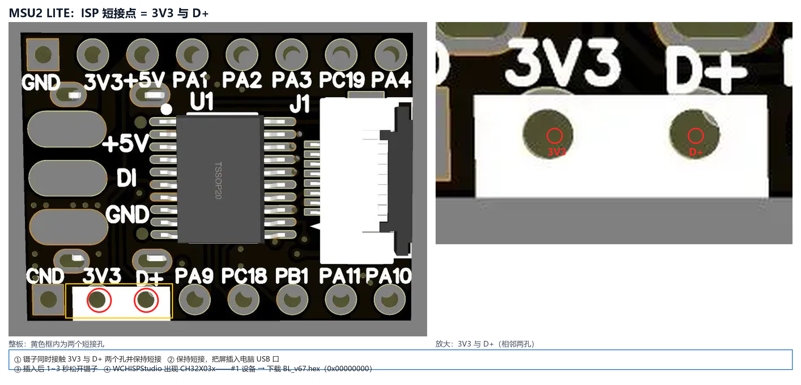

# 硬件资料 / Hardware Reference

> 本项目是**第三方非官方**自定义固件，与 MSU2 LITE 的原厂/品牌方无关。
> 下列资料仅用于开发与回退，版权归各自所有者。

本目录收集 MSU2 LITE 硬件（CH32X033F8P6 + GC9307 320×172 面板）的公开资料与实测记录。

## 目录

```
docs/
├─ datasheet/
│   ├─ wch_ds.pdf              WCH 芯片数据手册
│   ├─ riscv-board.pdf         板卡硬件说明
│   └─ MSU2-dev-guide.pdf      原厂开发指南
├─ schematic/
│   ├─ sch_mcu_right.png       MCU 侧原理图（右侧）
│   └─ sch_u3.png              U3 器件原理图
└─ images/
    ├─ factory_flash_8MB.bin   原厂外部 Flash 完整备份（W25Q64 8MB）
    ├─ vendor_app.bin          原厂 APP 固件
    ├─ boot_background.png     开机图参考
    └─ dashboard_reference.png 仪表盘布局参考
```

## 核心器件

| 器件 | 型号 | 关键参数 |
|---|---|---|
| MCU | CH32X033F8P6 | RISC-V RV32IMAC @48MHz，62KB Flash，20KB SRAM，USBFS |
| 显示驱动 | GC9307 | 172×320 IPS，4-wire SPI，RGB565/666 |
| 外部 Flash | 8MB SPI NOR | MSU2 LITE 实测 8MB，4KB 扇区 |
| 可见区域 | 1.47" | 320×172（横屏使用） |

## 引脚分配（来自固件，已实测）

| 功能 | 引脚 | 说明 |
|---|---|---|
| LCD SCK | PA5 | SPI1 SCK |
| LCD MOSI | PA7 | SPI1 MOSI |
| LCD DC / Flash MISO | **PA6** | 复用！切 Flash 时须改方向 |
| LCD RST | PA0 | 复位（低有效） |
| LCD CS | PC3 | 片选（低有效） |
| Flash CS | PB7 | 片选（低有效） |
| USB D+ / D- | — | CH32X035 USBFS，CDC 虚拟串口 |

**注意**：PA6 同时用于 LCD 的 DC 与 Flash 的 MISO，任何读 Flash 的操作都必须先把 LCD CS 拉高，
否则会中断正在进行的窗口写入（这是最容易踩的坑）。

## 内部 Flash 分区（62KB）

| 地址 | 用途 | 大小 |
|---|---|---|
| 0x0000–0x2FFF | Bootloader | 12 KB |
| 0x3000 | 升级标志 + 屏幕方向（第 4/5 字节） | 256 B |
| 0x3100 | 元数据（APP 长度 / CRC） | 256 B |
| 0x3200–0x91FF | 开机图（RLE） | 24 KB |
| 0x9200–0xF6FF | APP | 25.8 KB |
| 0xF700 | 预留（自检暂存） | 256 B |

## 外部 Flash 分区（8MB）

| 地址 | 用途 | 大小 |
|---|---|---|
| 0x020000–0x03FFFF | APP 背景图（RGB565 RLE） | 128 KB |
| 0x040000–0x0FFFFF | 字库（.afont 多字面） | 768 KB |
| 其余 | 空闲（可用于日志/资源） | ~7 MB |

## 还缺的资料（待补充）

| 项目 | 重要性 | 说明 |
|---|---|---|
| **GC9307 数据手册** | 高 | 目前初始化序列是照厂商示例改的，缺少寄存器全表 |
| **面板模组规格书** | 高 | 型号、视角、亮度、色域、机械尺寸、FPC 定义 |
| **完整原理图 PDF** | 高 | 现有只有两张局部截图，缺整页与网络标号 |
| **PCB 布局 / Gerber** | 中 | 排查 EMI、走线阻抗、去耦位置时需要 |
| **机械图（STEP/DWG）** | 中 | 外壳设计、开孔尺寸、视窗公差 |
| **背光驱动参数** | 中 | LED 串并数、限流电阻、PWM 调光是否可用 |
| **W25Q64 数据手册** | 低 | 常见器件，时序已知 |
| **USB 接口与 ESD 保护** | 低 | 连接器型号、保护器件 |
| **测试点 / 烧录接口定义** | 中 | SWD 引脚位置，便于工厂烧录 |
| **功耗实测数据** | 低 | 背光全亮/熄灭、待机电流 |

## 版本

- 资料整理：2026-11-22
- 固件：APP v104 / BL v67


## 进入芯片 ISP 烧录模式（首次烧录 BL）

MSU2 LITE 板上丝印已经把短接点标出来了：板子下边缘的**白色丝印框内有两个过孔**，
分别对应 **3V3** 与 **D+**（USB D+）。



### 操作

1. 用金属镊子**同时接触 3V3 与 D+ 两个孔**，保持短接不松手；
2. 保持短接，把屏插入电脑 USB 口；
3. 插入后 **1~3 秒** 松开镊子；
4. WCHISPStudio 中出现 `CH32X03x——#1 设备` → 选择 `BL_v67.hex`，
   起始地址 `0x00000000` → 下载。

### 原理

把主控第 6 脚 **PC17 / USB_D+** 在复位瞬间拉到 3.3V，芯片进入内置 USB ISP 模式。
这与厂商通用指南的描述一致，只是 MSU2 LITE 的孔位与丝印布局和通用系列不同。

### 板载丝印一览（本板）

| 边缘 | 标注 |
|---|---|
| 上边缘 | GND · 3V3 · +5V · PA1 · PA2 · PA3 · PC19 · PA4 |
| 左侧焊盘 | +5V · DI · GND |
| 下边缘 | GND · **3V3** · **D+** · PA9 · PC18 · PB1 · PA11 · PA10 |

> 参考：`schematic/vendor-generic/` 里保留的是厂商通用系列的短接示意，**不要**按那张图找孔位。

## 外部 Flash 容量

| 型号 | 容量 | 页/扇区 | 说明 |
|---|---|---|---|
| **MSU2 LITE** | **8 MB** | 256 B 页 / 4 KB 扇区 | 本项目目标硬件（实测） |
| MSU2（1.54"）/ MSU2_MINI | 1 MB（P25D80） | 256 B 页 | 厂商通用系列，非本项目目标 |

本项目布局按 1MB 之内设计，因此在两种容量的板子上都能工作：

| 地址 | 用途 | 结束地址 |
|---|---|---|
| 0x020000–0x03FFFF | APP 背景（128KB） | 0x03FFFF |
| 0x040000–0x0FFFFF | 字库（768KB） | 0x0FFFFF |

> 8MB 板子上，`0x100000` 以后为未使用空间，可用于日志、多套背景或更多字库。
> 实际容量以 `INFO` 命令返回值为准。

